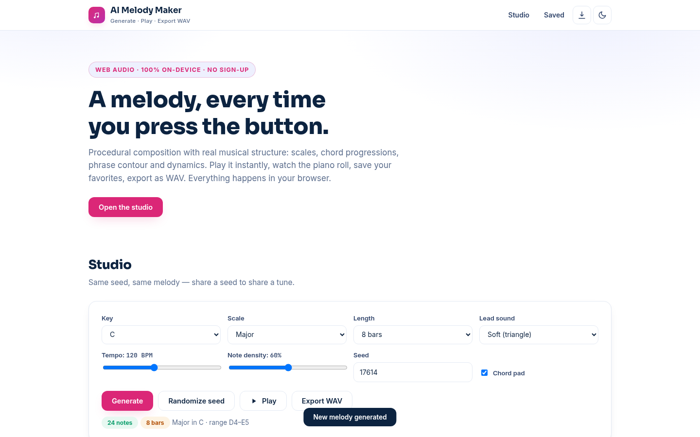

# AI Melody Maker — Generate, Play & Export Melodies Free

**Live:** https://akash991833.github.io/ai-melody-maker/

Generate original melodies with real musical structure: six scales, chord progressions, phrase contour and dynamics. Play them instantly with Web Audio, watch the piano roll, save your favorites, export as WAV. Same seed, same melody — share a seed to share a tune. Everything runs in your browser. No sign-up, no uploads.



## Features

- **Procedural composition** — seeded random-walk over scale degrees with chord-tone bias on strong beats, phrase arcs that rise and resolve, and a tonic ending
- **6 scales, 12 keys** — major, natural minor, both pentatonics, blues and dorian
- **Chord pad** — automatic I-IV-V-vi progressions under the melody, toggleable
- **Full control** — tempo (60-200 BPM), note density, 4/8/16 bars, four lead timbres
- **Piano roll** — canvas visualization with bar lines, note names and a live playhead
- **WAV export** — offline-rendered 44.1kHz stereo WAV via OfflineAudioContext
- **Save melodies** — keep up to 20 favorites in localStorage, reload any time
- **PWA** — installable, works fully offline
- **Dark & light themes**, responsive on mobile and desktop

## How it works

1. **Seed** — a mulberry32 PRNG makes every melody reproducible from its seed
2. **Random walk** — the melody moves by mostly stepwise motion over the scale, biased toward chord tones on strong beats
3. **Phrase shaping** — rests thin out at bar starts and before phrase ends; contour rises early and resolves to the tonic
4. **Synthesis** — each note is an oscillator with an exponential-decay envelope; pads use longer soft-triangle chords
5. **Export** — the same scheduler renders into an OfflineAudioContext, encoded to 16-bit PCM WAV

## Honest limits

Melodies come from musical rules plus seeded randomness, not a neural network trained on real songs. They are sketches and starting points, not finished productions. Sound is basic oscillator synthesis — clean, chiptune-ish timbre, not real instruments. There is no melody editing on the roll (yet), no MIDI export, and saved melodies live only in this browser.

## Tech

Vanilla HTML/CSS/JS + Web Audio API. No build step, no backend, no tracking.

## Run locally

```bash
python3 -m http.server 8000
# open http://localhost:8000
```

Built by [Akash Vishwakarma](https://github.com/AKASH991833). Free to use — no sign-up, no card.
